# Módulo 1: Fundamentos de Fluoroscopía e Introducción al Manejo del Arco en C (Intensificador de Imagen y Flat Panel)

## Abstract
**Resumen:** El uso de imágenes intraoperatorias mediante fluoroscopia (Arco en C) ha revolucionado las técnicas de cirugía ortopédica y traumatología, permitiendo intervenciones mínimamente invasivas y una restitución anatómica más precisa. En la práctica clínica moderna hacia el estándar 2026, la tecnología ha evolucionado vertiginosamente desde los tradicionales tubos intensificadores de imagen analógicos hacia los detectores de panel plano de estado sólido (Flat Panel Detectors - FPD), asistidos por algoritmos de inteligencia artificial para reducción de ruido en tiempo real. Sin embargo, el personal de quirófano continúa sometido a una exposición crónica a la radiación ionizante si no aplica principios rigurosos de radioprotección. Este módulo introduce el programa de capacitación teórico-práctica fundamentado en la filosofía **S.E.R.** (Seguridad, Eficiencia y Responsabilidad). El objetivo primario es establecer un criterio radiológico sólido en el cirujano que mitigue los riesgos ocupacionales a largo plazo sin comprometer los resultados clínicos.

---

## 1. Introducción
En la traumatología moderna, el Arco en C es una herramienta insustituible. Si bien los cirujanos ortopedistas no suelen estar clasificados estrictamente como "trabajadores de la radiación" bajo las normativas convencionales, la literatura demuestra que están sujetos a niveles significativos de exposición ocupacional a lo largo de su carrera (*Singer, 2005*). En 2010, la FDA lanzó una iniciativa para reducir la radiación médica innecesaria, destacando que de todas las modalidades diagnósticas, **la fluoroscopia intraoperatoria es la única bajo control directo del cirujano** (*Shuler et al., 2013*).

Sin embargo, existe un alarmante déficit formativo: estudios recientes evidencian que solo el 18% de los médicos residentes en entrenamiento quirúrgico han leído literatura sobre bioseguridad radiológica, únicamente el 24% emplea protección tiroidea de forma habitual y hasta un 62% desconoce los protocolos de protección en embarazo (*Kaplan et al., 2016*). Esta falta de formación reglada ha provocado que muchos especialistas dependan empíricamente del personal técnico o de la instrumentación quirúrgica, comprometiendo la eficiencia del procedimiento y la seguridad de todo el equipo de quirófano.

La pregunta fundamental en la sala de cirugía contemporánea no es simplemente si la fractura está reducida, sino: **¿Quién está a cargo del manejo integral y seguro del fluoroscopio?** 

---

## 2. La Filosofía de Intervención: S.E.R.
Para abordar este déficit formativo y estandarizar la interacción con el Arco en C, el presente curso se sustenta en tres pilares conceptuales denominados **S.E.R.**:

### 🛡️ S - Seguridad (Safety)
La radiación ionizante acarrea riesgos estocásticos y determinísticos bien documentados. Este pilar aborda:
* Las normativas de protección radiológica basadas en la dosis biológica y los límites ocupacionales internacionales (ICRP, OIEA) y nacionales (Resolución 1811).
* La protección del cristalino (con límite actualizado de 20 mSv/año), el tejido tiroideo y las extremidades distales del cirujano (las manos), siendo estas últimas las áreas anatómicas con mayor riesgo de exposición directa al haz primario (*Müller et al., 1998; Lee et al., 2012*).
* La desmitificación de dogmas intraoperatorios infundados (como la supuesta inocuidad a 3 pies sin EPP).

### ⏱️ E - Eficiencia (Efficiency)
Estudios clínicos demuestran que la estandarización y destreza técnica reducen drásticamente el tiempo de fluoroscopia y la radiación emitida (*Kaplan et al., 2016; Shuler et al., 2013*). En este pilar se fomenta:
* El conocimiento de los principios cinemáticos del equipo (incluyendo modelado redundante y control de colisiones) para la obtención de proyecciones anatómicas precisas en el primer intento.
* La reducción del número total de disparos mediante el empleo de fluoroscopia pulsada (1–6 imágenes/segundo frente a 30 imágenes/segundo continuas) y la función de impresión de última imagen (*Last Image Hold*).
* La estandarización de la terminología de comunicación verbal en quirófano para erradicar órdenes ambiguas, reduciendo tiempos y disparos en más del 50% (*Yeo et al., 2013; Kaplan et al., 2016*).

### 💼 R - Responsabilidad (Responsibility)
El equipo fluoroscópico representa una de las inversiones de capital más altas en una sala de cirugía.
* **Manipulación mecánica:** Procedimientos correctos de tracción, rotación y desplazamiento que evitan la fatiga del material y las colisiones con el campo estéril.
* **Mantenimiento preventivo e higiene:** Almacenamiento idóneo del monitor, cables de alta tensión, pedales y desinfección rigurosa de los elementos de radioprotección compartidos (como collares tiroideos) para evitar vectores de infección nosocomial (*Feierabend & Siegel, 2015*).

---

---

## 3. Fundamentos Físicos de la Radiación y Densidades Tisulares en Quirófano

### 3.1. Origen Histórico y Generación del Haz (Röntgen 1895)
El descubrimiento de los rayos X por Wilhelm Conrad Röntgen en 1895 transformó la medicina quirúrgica. En el tubo de fluoroscopia moderno, una corriente de electrones acelerada a alta tensión (~70-110 kV) colisiona contra un blanco de tungsteno rotatorio en vacío, liberando energía electromagnética ionizante de longitud de onda ultra-corta y alta frecuencia.

  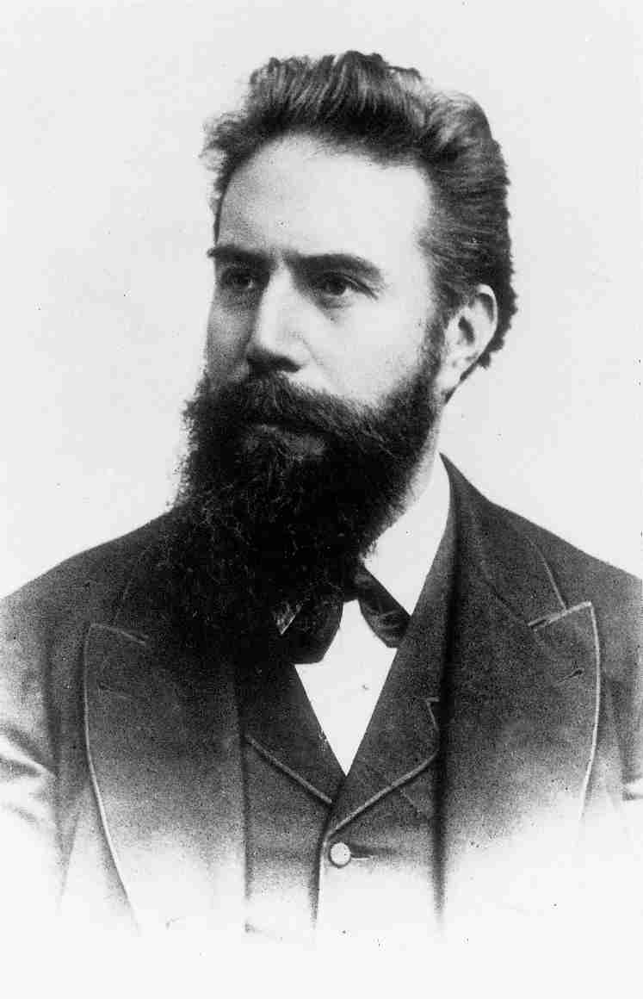
  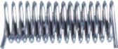
  
<em>Figura 1.1: Wilhelm Röntgen (1895) y esquema de producción de rayos X mediante blanco de tungsteno al vacío en el tubo emisor.</em>

  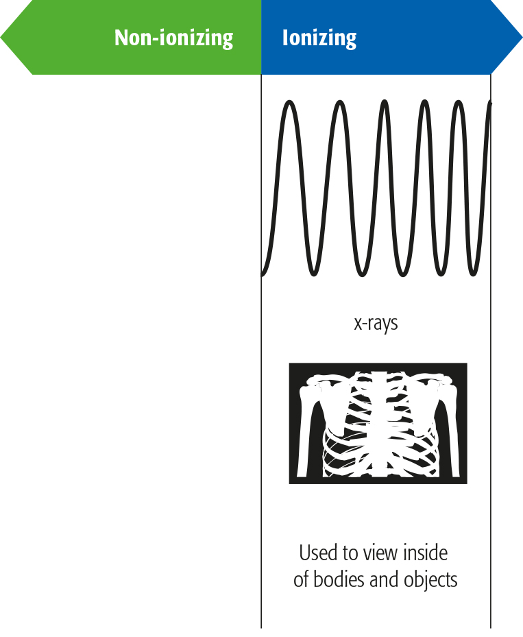
  
<em>Figura 1.2: Posición de los rayos X en el espectro electromagnético: radiación ionizante de longitud de onda corta capaz de arrancar electrones de la materia biológica.</em>

### 3.2. Las Cinco Densidades Radiológicas Clásicas en Traumatología
En una toma radiográfica o fluoroscópica, el nivel de atenuación fotónica determina si una estructura se observa **radiopaca** (blanca/clara) o **radiolúcida** (oscura/negra):
1. **Aire:** Radiolúcido absoluto (negro).
2. **Grasa:** Radiolúcido moderado (gris oscuro).
3. **Agua / Partes Blandas:** Atenuación intermedia (gris neutro).
4. **Hueso (Cortical y Esponjoso):** Radiopaco (blanco hueso con patrón trabecular).
5. **Metal:** Radiopaco absoluto (blanco puro brillante de implantes y prótesis).

  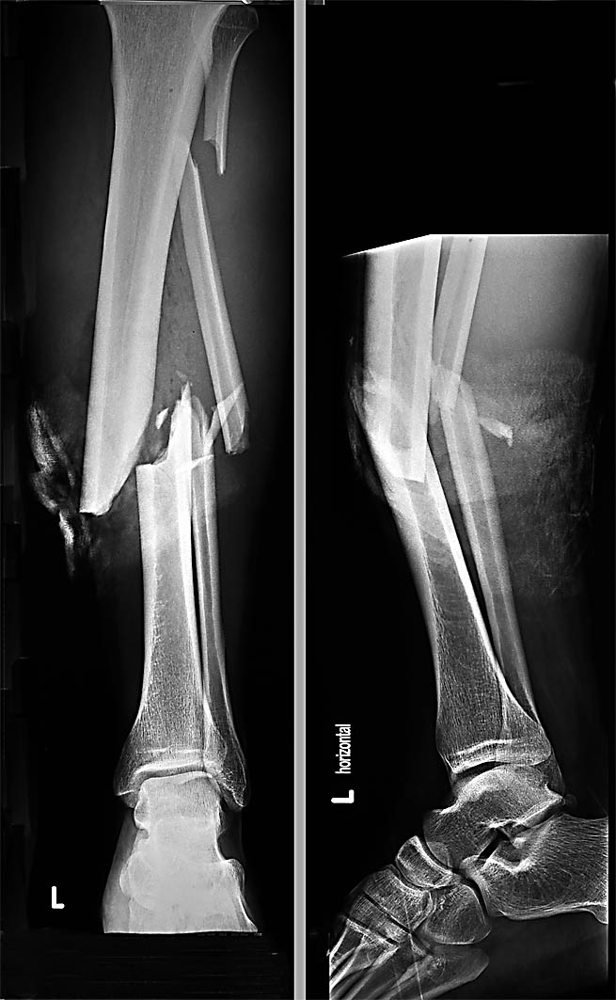
  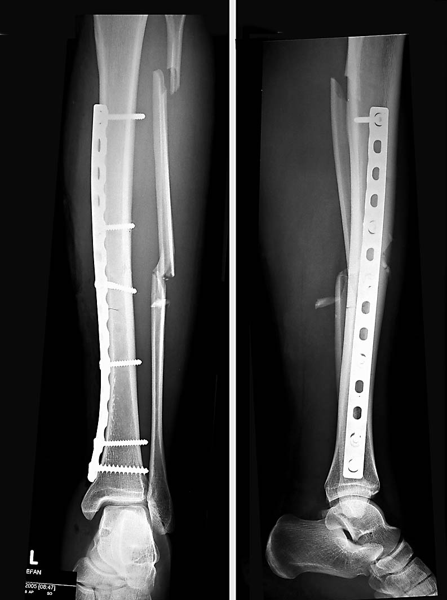
  
<em>Figura 1.3: Demostración de las 5 densidades en fractura expuesta de tibia: aire ambiental, tejidos blandos edematizados, cortical ósea y metal de la osteosíntesis.</em>

  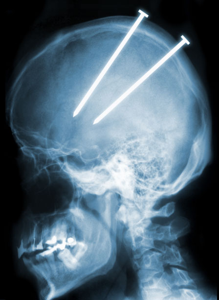
  
<em>Figura 1.4: Principio de absorción fotónica: las estructuras de alto número atómico (Z) absorben fotones (radiopacas), mientras que los tejidos de bajo Z permiten su paso (radiolúcidas).</em>

### 3.3. Dosis Ocupacionales y Lesiones Traumáticas Ocultas
La radiación natural de fondo ronda los 2-3 mSv/año a nivel del mar. En quirófano, cada segundo de exposición debe justificarse por el beneficio directo al paciente. 

  
  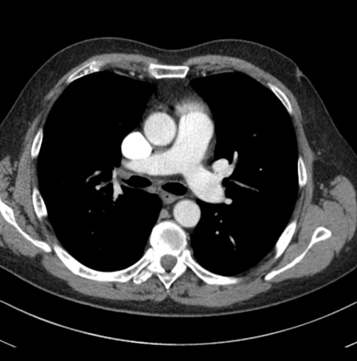
  
<em>Figura 1.5: Comparativa de dosis: desde radiación cósmica y ambiental hasta procedimientos diagnósticos de alta dosis en medicina.</em>

Asimismo, la fluoroscopia y la radiología convencional presentan limitaciones diagnósticas en fracturas articulares complejas y lesiones osteocondrales:

  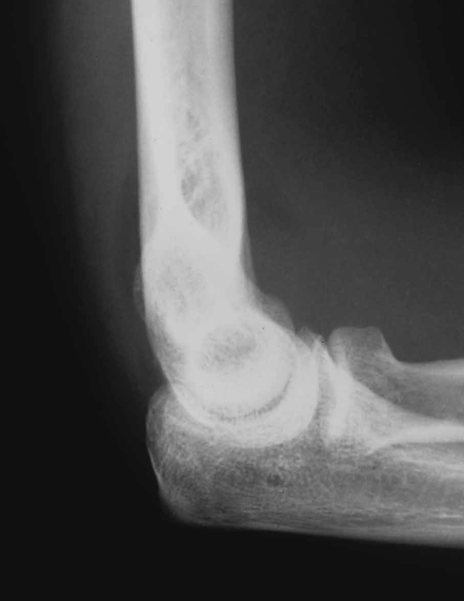
  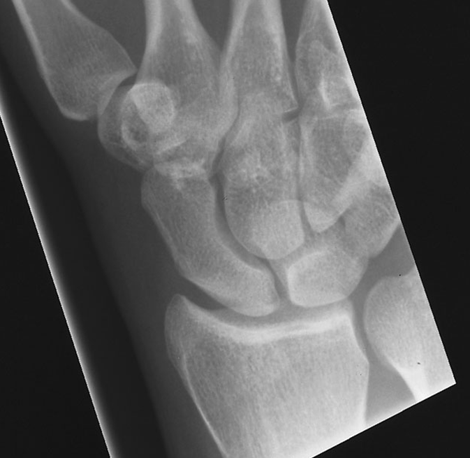
  
<em>Figura 1.6: Izquierda: Signo de la almohadilla grasa (lipohemartrosis) en codo traumático. Derecha: Fractura oculta de escafoides no visible en Rx convencional pero evidente en resonancia magnética.</em>

  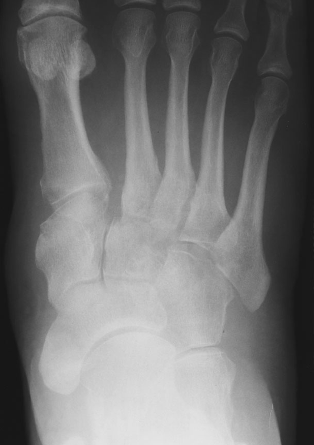
  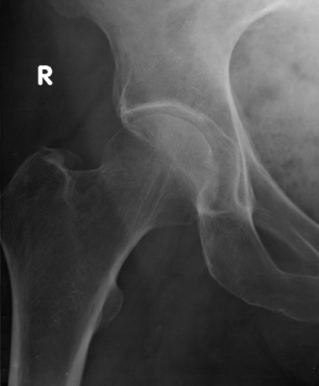
  
<em>Figura 1.7: Izquierda: Comparativa pie normal vs diástasis articular en fractura-luxación de Lisfranc. Derecha: Fractura oculta subcapital de cuello femoral detectada por RM tras radiografía normal.</em>

## 4. Conclusión
El entrenamiento en fluoroscopia debe considerarse tan vital como el entrenamiento en la técnica quirúrgica per se. Asumir el control y liderazgo en el manejo del intensificador de imágenes no solo optimiza los tiempos quirúrgicos, sino que garantiza una cultura de bioseguridad sostenible, protegiendo al paciente y salvaguardando la vida profesional del cirujano a largo plazo.

---

## Bibliografía
1. **Singer, G.** (2005). *Occupational radiation exposure to the surgeon.* Journal of the American Academy of Orthopaedic Surgeons, 13(1), 69-76.
2. **Kaplan, D. J., Patel, J. N., Liporace, F. A., & Yoon, R. S.** (2016). *Intraoperative radiation safety in orthopaedics: a review of the ALARA (As low as reasonably achievable) principle.* Patient Safety in Surgery, 10(1), 27.
3. **Shuler, F. D., Daigre, J. L., Pham, D., & Kish, V. L.** (2013). *Laser targeting with C-arm fluoroscopy: effect on image acquisition and radiation exposure.* Journal of Orthopaedic Trauma, 27(5), e97-e102.
4. **Lee, K., Lee, K. M., Park, M. S., Lee, B., Kwon, D. G., & Chung, C. Y.** (2012). *Measurements of surgeons' exposure to ionizing radiation dose during intraoperative use of C-arm fluoroscopy.* Spine, 37(14), 1240-1244.
5. **Müller, L. S., et al.** (1998). *Radiation exposure to the hands of orthopaedic surgeons during fluoroscopically guided procedures.* The Bone & Joint Journal, 80(4), 689-692.
6. **Feierabend, S., & Siegel, G.** (2015). *Potential infection risk from thyroid radiation protection.* Journal of Orthopaedic Trauma, 29(1), 18-20.
7. **International Commission on Radiological Protection (ICRP).** (2007). *The 2007 Recommendations of the International Commission on Radiological Protection.* ICRP Publication 103. Annals of the ICRP, 37(2-4), 1-332.
