# Módulo 2: Generalidades de la Radioprotección y Efectos Biológicos

## Abstract
**Resumen:** La radiación ionizante empleada en cirugía ortopédica conlleva riesgos significativos, categorizados en efectos estocásticos (dependientes de probabilidad) y determinísticos (dependientes de dosis). La evidencia indica que hasta el 80% de la radiación dispersa proviene del paciente, siendo esta la principal fuente de exposición para el equipo quirúrgico. Este módulo profundiza en los principios del ALARA (*As Low As Reasonably Achievable*), los límites de dosis establecidos por la ICRP, y estrategias comprobadas para mitigar la absorción tisular utilizando parámetros como la distancia geométrica (Ley del inverso del cuadrado) y el uso apropiado de barreras plomadas.

---

## 1. Introducción a la Radiación Ionizante y Magnitudes Dosimétricas
La radiación ionizante libera suficiente energía para remover electrones de los átomos, generando radicales libres y provocando rupturas en las cadenas de ADN (*Kaplan et al., 2016*). Para cuantificar la exposición en el entorno quirúrgico se distinguen dos conceptos físicos esenciales:
* **Dosis Absorbida:** Mide la cantidad de energía física depositada por unidad de masa. Sus unidades son el **Gray (Gy)** (1 Gy = 1 Joule/kg) y el **Rad** (1 Gy = 100 Rads).
* **Dosis Equivalente y Efectiva:** Estima el daño biológico real considerando el tipo de radiación y la radiosensibilidad tisular ($H = D \times Q$). Sus unidades son el **Sievert (Sv)** y el **Rem** (1 Sv = 100 Rem).

Para establecer un marco de referencia comparativo clínico:
* **Radiografía de Tórax (PA):** ~0.1 mSv
* **TAC de Cráneo:** ~1.5 mSv (Equivalente a 15 Rx de Tórax)
* **Fluoroscopia de extremidad estándar (1 min):** ~0.1 – 0.5 mSv
* **Fluoroscopia intraoperatoria continua directa:** hasta 12–40 mSv por minuto de haz directo (*Shuler et al., 2013*).
* **TAC de Cuerpo Entero:** ~9.9 mSv (Equivalente a 100 Rx de Tórax).

---

  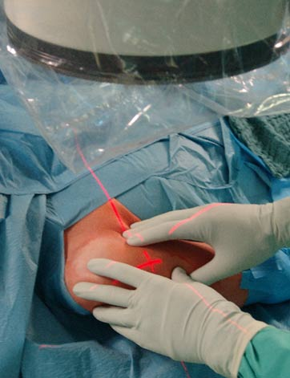
  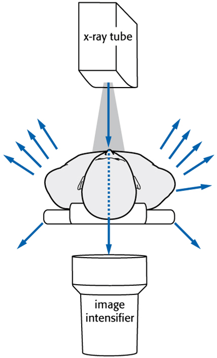
  
<em>Figura 2.1: Izquierda: Daño ocular y cataratas en cristalino por dosis ocupacional acumulada. Derecha: Física de absorción y dispersión AO Trauma: el paciente absorbe el 80% del haz primario, emite 10-20% de radiación dispersa (scatter) hacia el equipo, y solo el 2% llega al detector.</em>

## 2. Clasificación de los Efectos Biológicos y Límites de Dosis

La literatura radiológica clasifica el daño celular en dos espectros (*Kaplan et al., 2016; Lee et al., 2012*):
1. **Efectos Determinísticos:** Ocurren cuando se supera un umbral crítico de dosis. La gravedad del daño es directamente proporcional a la dosis por encima de dicho umbral. Incluyen eritema cutáneo (>2 Gy), radiodermitis, quemaduras, alopecia transitoria/permanente y cataratas en el cristalino.
2. **Efectos Estocásticos:** No poseen un umbral seguro de dosis; cualquier exposición, por pequeña que sea, incrementa la probabilidad estadística de mutación genética o carcinogénesis debido al daño acumulativo en el ADN. Los más prevalentes en el personal médico son la leucemia y los carcinomas tiroideos.

### 2.1. El Cambio Paradigmático de la ICRP 118 en el Cristalino
Históricamente, las guías internacionales consideraban que el cristalino humano poseía un umbral alto de tolerancia a la radiación (entre 2 y 5 Gy) y permitían un límite ocupacional de 150 mSv/año. Sin embargo, estudios epidemiológicos rigurosos en cardiólogos intervencionistas, cirujanos ortopedistas y sobrevivientes demostraron que **las opacidades subcapsulares posteriores precoces y cataratas se inducen con dosis tan bajas como 0.5 Gy** (sin evidencia clara de dosis umbral segura).

En respuesta a esta evidencia, la **ICRP (Publicación 118)** y las Normas Básicas Internacionales de Seguridad del **OIEA (GSR Part 3)** redujeron radicalmente el límite ocupacional para el cristalino en un **87%**:
* **Cristalino (Ojo):** **20 mSv/año** (promediado en períodos definidos de 5 años, sin exceder 50 mSv en un solo año; frente al obsoleto valor histórico de 150 mSv/año). El uso de gafas plomadas de 0.5 a 0.75 mm Pb con protección lateral es hoy mandatorio en cualquier procedimiento fluoroscópico prolongado.
* **Piel y Extremidades (Manos/Pies):** **500 mSv/año** (50,000 mrem/año).
* **Dosis Efectiva Global de Cuerpo Entero:** Máximo de **50 mSv** en un solo año, promediado a no más de **20 mSv/año** en un ciclo continuo de 5 años (Resolución 1811 de Colombia).

---

## 3. Evidencia Científica: Dosimetría Orgánica Específica, Regla de la Distancia y Dosimetría Activa

### 3.1. Dosimetría por Órganos en Quirófano (Lee et al., Spine 2012)
Estudios rigurosos con fantomas antropomórficos revelan diferencias críticas en la radiación dispersa según el órgano anatómico:
* **El haz directo a las manos es al menos 20 veces superior a la dispersión:** La tasa directa a las manos puede alcanzar 377.2 $\mu$Gy/min frente a 9–18 $\mu$Gy/min de dispersión (*Lee et al., 2012*).
* **Mama como órgano de máxima absorción dispersa:** En procedimientos de columna y tórax, el tejido mamario registra las tasas más altas de radiación dispersa (18.6 a 81.6 $\mu$Gy/min), mientras que las gónadas registran las más bajas en esa configuración.
* **Maniobra conductual de rotación cefálica a 90°:** Cuando se dispara el pedal, el simple acto de **girar la cabeza del cirujano 90° en dirección opuesta al paciente** reduce la dosis de radiación dispersa al cristalino y tiroides de forma estadísticamente significativa sin costo alguno (*Lee et al., 2012*).
* **Eficacia del protector tiroideo:** El uso de collar tiroideo plomado reduce la tasa de radiación a la glándula en un **88.9%** (de 15.63 a 1.73 $\mu$Gy/min) (*Lee et al., 2012*).

### 3.2. Dispersión a 1, 3 y 6 Pies y Desmitificación de la "Regla de los 3 Pies" (Shuler et al., 2013)
* **A 1 pie (30.5 cm):** La dispersión gonadal es **12 veces mayor** que la dosis tiroidea (66.9–68.3 mrem vs 5.4–5.6 mrem), debido a la deflexión primaria que emana de la mesa y la pelvis del paciente (*Shuler et al., 2013*).
* **A 3 pies (91.5 cm):** Históricamente, la regla de los 3 pies (*Mehlman & DiPasquale, 1997*) sugería ausencia de radiación porque utilizaba dosímetros con un umbral de detección insensible de 10 mrem. Sin embargo, con dosímetros OSL modernos (sensibilidad de 1 mrem), se comprueba que **sí existe radiación detectable a 3 pies** (1 mrem en tiroides y 10 mrem en gónadas por sesión de 12.65 min de fluoroscopia). En consecuencia: **el EPP plomado debe portarse obligatoriamente incluso si el profesional se ubica a más de 3 pies de distancia**.
* **A 6 pies (1.83 m):** La dispersión cae a **0 mrem** detectable (0.025% de la energía del haz), confirmando la potencia de la Ley del Inverso del Cuadrado ($I = 1/d^2$).

### 3.3. Dosimetría Activa Inalámbrica en Tiempo Real (Estándar 2026 vs. Dosimetría Pasiva TLD Diferida)
El monitoreo dosimétrico ha vivido una revolución tecnológica indispensable para la seguridad quirúrgica:
* **Limitación Crítica de los Dosímetros Pasivos Tradicionales (TLD / Película):** Los dosímetros clásicos de termoluminiscencia (TLD) se leen de manera mensual o trimestral. Funcionan como un registro legal y forense retrospectivo: informan al profesional de una sobredosis semanas después de que el daño biológico ha ocurrido, impidiendo cualquier corrección conductual intraoperatoria.
* **Sistemas de Dosimetría Activa en Tiempo Real (ej. RaySafe i3 / Unfors EDD):** En las salas quirúrgicas modernas hacia 2026, los miembros del equipo quirúrgico portan sensores electrónicos personales en el pecho que transmiten telemétricamente por radiofrecuencia a un monitor central en el quirófano.
* **Feedback Inmediato por Código de Colores:** La pantalla proyecta en vivo barras individuales tipo semáforo (**Verde:** exposición mínima; **Amarillo:** advertencia; **Rojo:** tasa de dispersión peligrosa) y la tasa instantánea en $\mu\text{Sv/h}$ en el segundo exacto en que se pisa el pedal.
* **Impacto Conductual Comprobado:** El biofeedback visual permite que el cirujano asistente, el instrumentador o el anestesiólogo den un paso atrás de medio metro o giren la cabeza en tiempo real, logrando **reducciones de más del 60% en la dosis ocupacional acumulada** en quirófano sin alterar los tiempos quirúrgicos.

---

  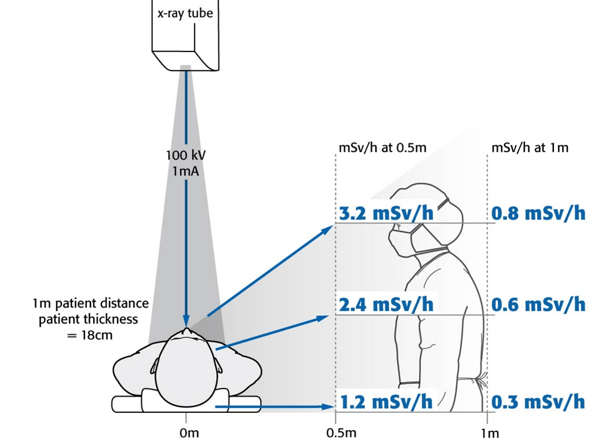
  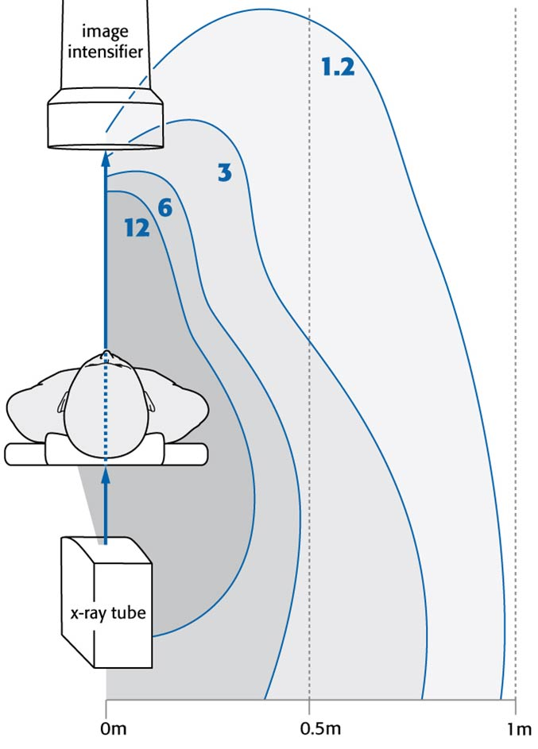
  
<em>Figura 2.2: Ley del Inverso del Cuadrado: duplicar la distancia reduce la radiación a la cuarta parte. A 3 metros de la fuente la dosis dispersa alcanza niveles prácticamente insignificantes.</em>

## 4. Estrategias de Blindaje y Nuevos Materiales No Plomados

### 4.1. Blindaje Convencional y Control de Infecciones
* **Delantales Plomados:** Espesor mínimo requerido de **0.50 mm Pb equivalente**, atenuando más del **95%** de los rayos X dispersos (*Kaplan et al., 2016*). Deben ser inspeccionados anualmente mediante fluoroscopia para descartar grietas internas por dobleces inadecuados.
* **Gafas Plomadas con Protección Lateral:** Las gafas de vidrio plomado (0.75 mm Pb) con viseras laterales reducen la exposición ocular hasta en un **90%** en cirugía pélvica y de cadera (*Burns et al., 2013; Kaplan et al., 2016*).
* **Higiene del Protector Tiroideo:** Los collares tiroideos son manipulados frecuentemente y compartidos entre el personal. La literatura alerta que representan un vector potencial de infecciones nosocomiales, por lo que **deben desinfectarse tras cada procedimiento quirúrgico** (*Feierabend & Siegel, 2015*).

### 4.2. Fibras Reductoras de Dosis de Sulfato de Bario ($BaSO_4$) (Cha et al., 2020)
Investigaciones recientes (*Journal of Radiation Research, 2020*) han desarrollado telas protectoras de fibra reductora de dosis (**DRF - Dose Reduction Fiber**) fabricadas con **sulfato de bario ($BaSO_4$)**, con un espesor de 2 mm equivalente a 0.1 mm Pb:
* **Eficacia de Blindaje:** Reducen la dosis absorbida en la superficie posterior del paciente entre un **25.3% y 88.8%**, y en la superficie anterior entre un **55.3% y 93.6%**.
* **Preservación de Calidad de Imagen:** A diferencia de los protectores de plomo masivo que inducen artefactos de endurecimiento de haz (*beam hardening*) y bandas (*streaking artifacts*), el $BaSO_4$ mantiene intacta la resolución de contraste (CR) y la función de transferencia de modulación (MTF).
* **Guía Clínica de Uso:** Se recomienda aplicar el blindaje de $BaSO_4$ en la cara posterior del paciente en la región de interés (ROI), y en ambas caras (anterior y posterior) fuera del ROI, maximizando la radioprotección de cirujano y paciente sin interferir en el campo quirúrgico.

---

## 5. Geometría Crítica de Dispersión: Posicionamiento del Tubo
* El **80%** del haz primario interactúa con el paciente. Del **10% al 20%** restante emerge como radiación dispersa (efecto Compton), rebotando principalmente hacia el lado de ingreso del haz.
* **Configuración Estándar AP (Tubo abajo, Intensificador arriba):** La mayor parte de la dispersión de alta energía se proyecta hacia el suelo y las extremidades inferiores del cirujano (protegidas por el delantal y la mesa). La configuración invertida (tubo arriba) triplica la radiación hacia los ojos, tiroides y tórax del cirujano (*Lee et al., 2012; Kaplan et al., 2016*).
* **Proyección Lateral:** El cirujano debe posicionarse siempre del lado del **intensificador de imágenes** (detector), nunca del lado del tubo emisor, donde la tasa de dispersión es hasta 25 veces mayor (0.53 mSv/min frente a 0.02 mSv/min).

---

  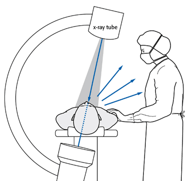
  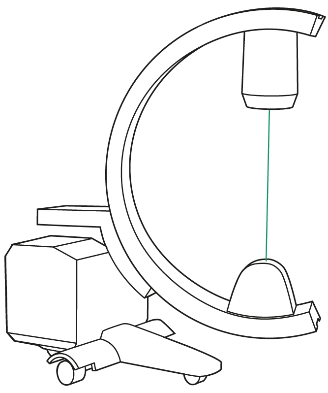
  
<em>Figura 2.3: Configuración geométrica en proyección anteroposterior. Correcto (Izquierda): Tubo debajo de la mesa y receptor arriba (la radiación retrodispersa impacta las extremidades inferiores del personal). Incorrecto (Derecha): Tubo arriba (el scatter impacta directamente la cabeza, ojos y tiroides del cirujano).</em>

  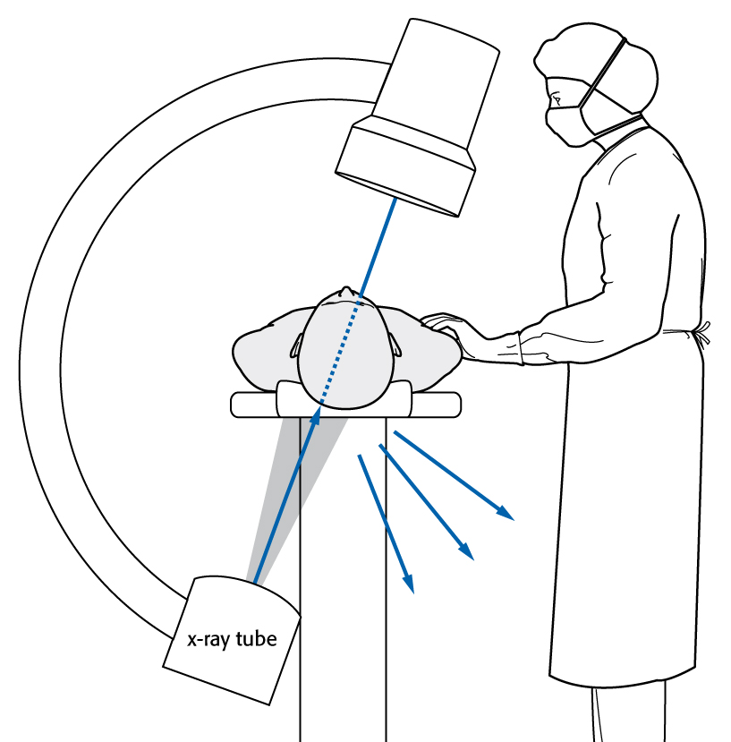
  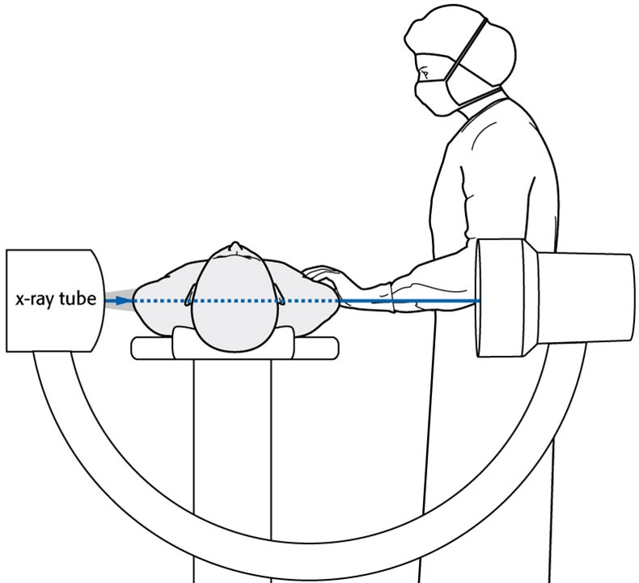
  
<em>Figura 2.4: La regla de oro internacional de AO Trauma: "Hug the Intensifier!" En proyección lateral, el cirujano debe situarse del lado del intensificador/detector. Del lado del tubo, el torso recibe 25 veces más dosis y la tiroides 3 a 4 veces más radiación dispersa.</em>

### 5.1. La Regla de Oro Internacional de AO Trauma: "Hug the Intensifier!"
La evidencia curricular de la **AO Foundation / AO Trauma** establece directrices estrictas para el personal de quirófano:
* **Scatter Asimétrico en Proyección Lateral:** Del lado del tubo emisor de rayos X, la tasa de radiación dispersa al torso del cirujano es **25 veces mayor** y a la región tiroidea es **3 a 4 veces mayor** que del lado del intensificador/detector (*AO Trauma Radiation Hazards; Lee et al., 2012*). 
* **Regla "Hug the Intensifier!":** El cirujano, instrumentador y enfermeros deben mantenerse siempre del lado del intensificador de imagen y lo más lejos posible del tubo generador de rayos X.
* **Vulnerabilidad Crítica del Asistente Quirúrgico:** Estudios en cirugías ortopédicas consecutivas revelan que mientras el cirujano principal suele ubicarse a >90 cm del haz central, el primer asistente quirúrgico se sitúa con frecuencia a escasos **10 cm del haz**, absorbiendo la mayor carga de dosis si no se corrige su posición.
* **Advertencia Verbal Obligatoria:** Jamás se debe pisar el pedal de exposición en silencio. El protocolo de AO Trauma exige exclamar en voz alta **"¡Disparo!"** o **"¡Screening!"** antes de accionar el haz para que ningún miembro del equipo invada el campo de dispersión.

### 5.2. Delimitación de Áreas Controladas en Quirófano Móvil (Estándar ACHS / OIEA)
De acuerdo con las guías operacionales de seguridad radiológica (*Manual de Seguridad Radiológica ACHS*):
* **Perímetro de Seguridad de 2 Metros:** Durante el funcionamiento de un Arco en C móvil en quirófano, se define un área controlada temporal de **2 metros de radio** alrededor del paciente y del tubo emisor.
* **Restricción de Acceso:** Queda estrictamente prohibida la permanencia de personal dentro de este radio de 2 metros durante la activación del haz si no portan su EPP plomado reglamentario. Aquellos miembros del equipo sin blindaje deben situarse obligatoriamente fuera del radio de 2 metros (idealmente a más de 3 metros) o detrás de mamparas plomadas móviles.

### 5.3. Protocolo de Protección Radiológica en Gestación (Personal Quirúrgico Embarazado)
Estudios formativos (*Kaplan et al., 2016*) revelan que hasta un **62% de los residentes desconoce los protocolos de bioseguridad en embarazo**, generando temores infundados o conductas negligentes. El consenso internacional (*ICRP Publicación 84, OIEA GSR Part 3 y Resolución 1811*) establece:
* **Límite Fetal Estricto:** Una vez declarada la gestación, el feto se clasifica como miembro del público general. El límite de dosis acumulada durante todo el resto del embarazo es de **1 mSv al feto** (o no exceder 2 mSv en la superficie del abdomen materno).
* **Blindaje Reforzado Obligatorio:**
  1. Uso de **delantal envolvente de maternidad con faja de soporte pélvico** o **superposición de dos delantales frontales (0.5 mm + 0.5 mm = 1.0 mm Pb equivalente)** sobre el abdomen grávido, atenuando más del 99% de los fotones dispersos.
  2. Uso riguroso de protector tiroideo y gafas plomadas con protección lateral.
* **Dosimetría Fetal Específica:** Es mandatorio solicitar un **segundo dosímetro personal mensual** que se porta **debajo del delantal plomado a la altura del abdomen**, registrando exclusivamente la dosis que penetra la barrera de plomo hacia el útero.
* **Gestión Ergonómica y de Distancia:** La cirujana o instrumentadora gestante no debe ser discriminada de su labor formativa ni clínica; basta con optimizar la distancia (mantenerse a $\ge 2$ metros del tubo emisor durante el disparo o detrás de mamparas plomadas móviles en proyecciones laterales de alta dispersión).

### 5.4. El Checklist Pre-Disparo de 5 Puntos ("Protocolo 5-P" de Quirófano)
En situaciones de estrés intraoperatorio o politraumatismo, los profesionales suelen olvidar cifras numéricas. Para garantizar una disciplina operativa infalible antes de presionar el pedal, se establece el **Protocolo 5-P**:

| Punto | Parámetro Crítico | Verificación Operativa en Quirófano |
| :---: | :--- | :--- |
| **1. P** | **Posición del Tubo** | ¿El tubo emisor se encuentra **debajo de la camilla** (o en lado opuesto en lateral)? |
| **2. P** | **Proximidad del Detector** | ¿El receptor (FPD / Intensificador) está **lo más pegado posible al paciente**? |
| **3. P** | **Precisión (Láser y Colimación)** | ¿Se usó puntero láser y se **colimó al área estricta**, eliminando radiación al aire? |
| **4. P** | **Pulsado en Consola** | ¿La tasa está configurada en **4 u 8 pps** (o Media Dosis / Cuarto de Dosis)? |
| **5. P** | **Proclamación ("¡Disparo!")** | ¿Se anunció en voz alta **"¡Disparo!"** y se verificó el radio de 2 metros despejado? |

---

  
  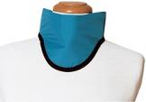
  
<em>Figura 2.5: Equipo de Protección Personal: Mandil de 0.5 mm Pb (reduce 16x frontalmente y 4x lateralmente) y protector tiroideo (el 85% de los carcinomas papilares se relacionan con radiación).</em>

  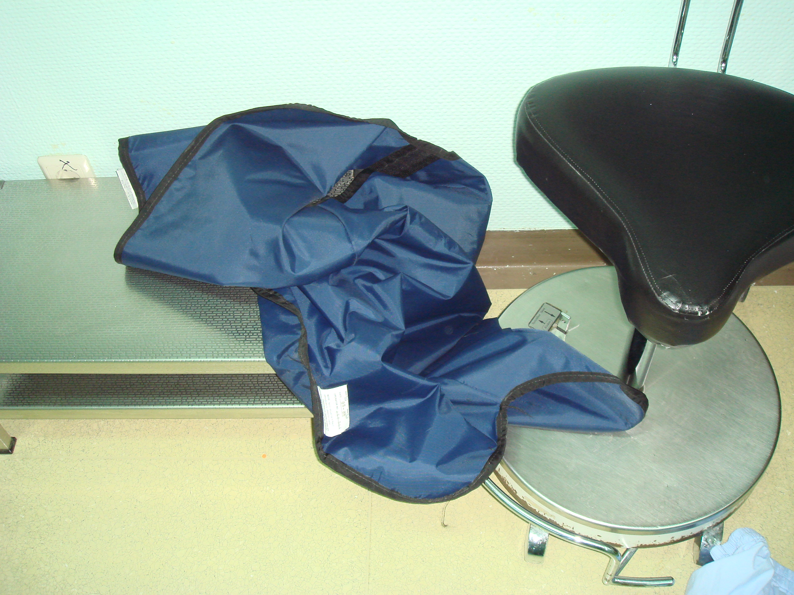
  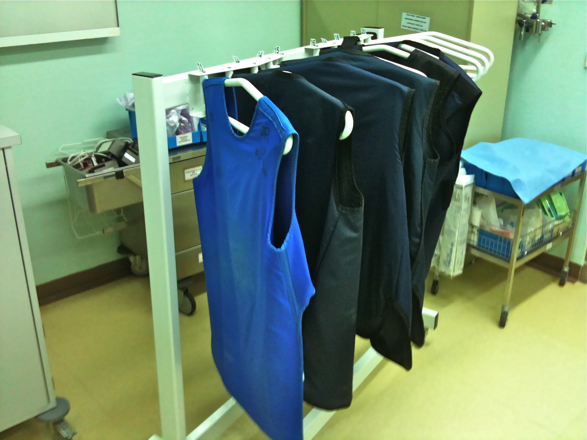
  
<em>Figura 2.6: Mantenimiento del blindaje: Si el mandil se dobla o se deja en el suelo, el plomo interno se fisura (Izquierda, escaneo radiográfico). Debe almacenarse siempre en perchas murales dedicadas (Derecha).</em>

  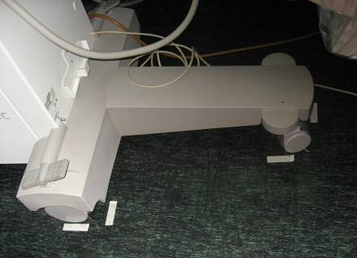
  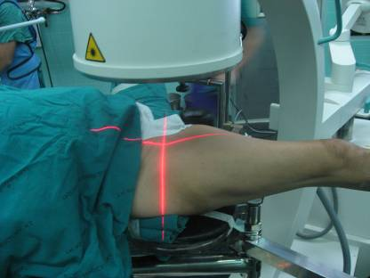
  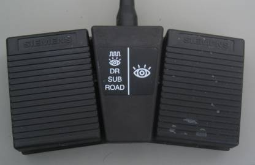
  
<em>Figura 2.7: "C-arm attitude" de AO Trauma: Marcas en el piso para retornos mecánicos rápidos, puntería láser para centrado sin disparos de prueba, y fluoroscopia pulsada (1 seg = 15-25 cuadros con menor dosis).</em>

## 6. Conclusión
El riesgo oncológico y determinístico en cirugía ortopédica es completamente controlable mediante el principio ALARA:
1. Mantener el tubo debajo de la mesa y el intensificador pegado al paciente.
2. Usar EPP verificado anualmente (delantal $\ge$0.5 mm Pb, collar tiroideo desinfectado y gafas con protección lateral).
3. Aplicar rotación de cabeza a 90° durante el disparo si no se cuenta con gafas.
4. Conocer que la dispersión a 1 pie es 12 veces mayor a nivel gonadal y que a 3 pies se requiere EPP completo.
5. Respetar el límite gestacional de 1 mSv al feto con doble delantal y dosímetro abdominal en personal embarazada.
6. Aplicar metódicamente el Checklist 5-P antes de cada disparo de fluoroscopia.

---

## Bibliografía
1. **Kaplan, D. J., Patel, J. N., Liporace, F. A., & Yoon, R. S.** (2016). *Intraoperative radiation safety in orthopaedics: a review of the ALARA (As low as reasonably achievable) principle.* Patient Safety in Surgery, 10(1), 27.
2. **Lee, K., Lee, K. M., Park, M. S., Lee, B., Kwon, D. G., & Chung, C. Y.** (2012). *Measurements of surgeons' exposure to ionizing radiation dose during intraoperative use of C-arm fluoroscopy.* Spine, 37(14), 1240-1244.
3. **Shuler, F. D., Daigre, J. L., Pham, D., & Kish, V. L.** (2013). *Laser targeting with C-arm fluoroscopy: effect on image acquisition and radiation exposure.* Journal of Orthopaedic Trauma, 27(5), e97-e102.
4. **Cha, H., Lee, K., Park, M. S., Lee, K. M., Cho, K., & Sung, K. H.** (2020). *Shielding effect of radiation dose reduction fiber during the use of C-arm fluoroscopy: a phantom study.* Journal of Radiation Research, 61(5), 705-711.
5. **Burns, S., Thornton, R., Dauer, L. T., et al.** (2013). *Leaded eyeglasses substantially reduce radiation exposure of the surgeon’s eyes during acquisition of typical fluoroscopic views of the hip and pelvis.* Journal of Bone and Joint Surgery (Am), 95(14), 1307-1311.
6. **Feierabend, S., & Siegel, G.** (2015). *Potential infection risk from thyroid radiation protection.* Journal of Orthopaedic Trauma, 29(1), 18-20.
7. **ICRP.** (2012). *ICRP Statement on Tissue Reactions / Early and Late Effects of Radiation in Normal Tissues and Organs — Threshold Doses for Tissue Reactions in a Radiation Protection Context.* ICRP Publication 118. Annals of the ICRP, 41(1/2).
