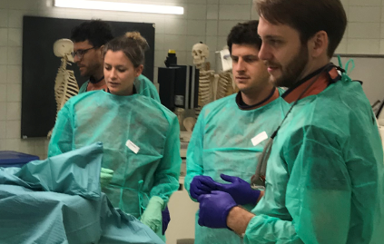
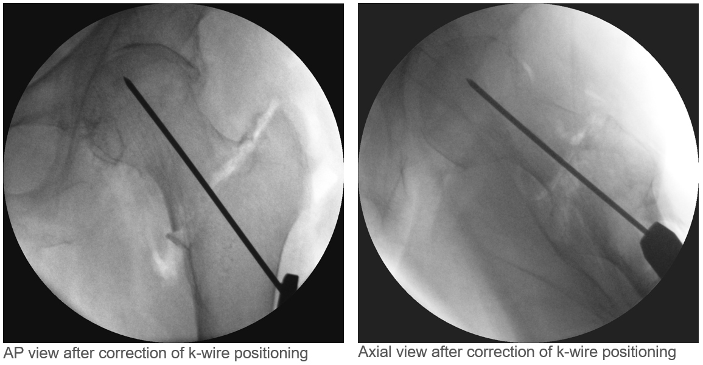
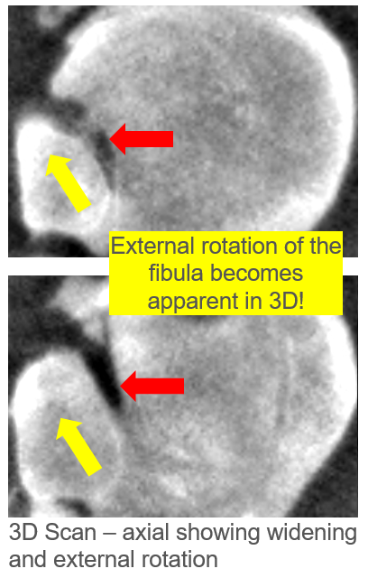
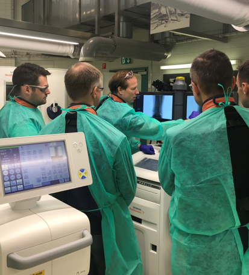

# Módulo 4: Protocolos de Posicionamiento Fluoroscópico para Miembro Inferior

## Abstract
**Resumen:** La traumatología y ortopedia del miembro inferior involucra estructuras anatómicas de alta densidad (ej., pelvis, fémur proximal), lo cual requiere un ajuste dosimétrico superior y un posicionamiento impecable del paciente y del Arco en C. La evidencia científica (Müller et al.) indica que los procedimientos de fijación femoral (clavo cefalomedular) inducen los picos más altos de radiación secundaria absorbida por el cirujano. Este módulo revisa la biomecánica posicional del fluoroscopio para la adquisición ortogonal de la cadera, rodilla y tobillo, mitigando disparos iterativos fallidos y minimizando la retrodifusión (backscatter).

---

## 1. Introducción y Consideraciones Biomecánicas del Miembro Inferior
La obtención de imágenes diagnósticas en tiempo real durante cirugías del tren inferior es técnicamente desafiante debido a la interposición de las extremidades contralaterales, los soportes de la mesa de tracción y el notable grosor tisular de la pelvis y el muslo. 

A medida que el grosor anatómico y el índice de masa corporal (BMI) del paciente aumentan, la producción de **radiación dispersa crece de forma exponencial** (*Shuler et al., 2013; Kaplan et al., 2016*). El Control Automático de Brillo (ABC/AERC) compensa la atenuación elevando el kilovoltaje (kVp) y el miliamperaje (mA), lo que incrementa la tasa de dosis tanto para el paciente como para el equipo quirúrgico.

---

## 2. Fémur Proximal y Cadera: La Zona de Máxima Dispersión

### 2.1. Proyección Anteroposterior (AP) y Geometría Protectora
* **Ubicación del Tubo Emisor:** El tubo generador de rayos X debe posicionarse **estrictamente debajo de la mesa radiolúcida**, manteniendo el intensificador de imágenes en íntimo contacto con la cara anterior del muslo/cadera. 
* **Justificación Dosimétrica:** La cadera es la estructura de mayor densidad del miembro inferior. Situar el tubo debajo dirige el 80% de la altísima retrodispersión hacia el suelo y los miembros inferiores del personal (protegidos por el faldón plomado y la mesa), salvaguardando el cristalino y la tiroides (*Kaplan et al., 2016; Lee et al., 2012*).
* **Dosimetría Gonadal vs. Tiroidea (Shuler et al., 2013):** A 1 pie de distancia de la cadera, la radiación dispersa a nivel gonadal es **12 veces mayor** que a nivel tiroideo (68 mrem vs 5.5 mrem).

### 2.2. Proyección Translateral (Axial de Cadera) y Regla del Lado Opuesto
* Para obtener la visión látero-medial del cuello femoral sin desestabilizar la fractura, el arco se bascula orbitalmente hacia la horizontalidad clínica (~15° respecto al suelo).
* **Regla de Oro Translateral:** El cirujano y el personal de quirófano deben situarse siempre del **lado del intensificador de imágenes** (detector) y **en el lado opuesto al tubo emisor de rayos X**, donde la radiación dispersa es significativamente menor (*Lee et al., 2012; Kaplan et al., 2016*).

### 2.3. Comportamiento de la Puntería Láser en Cadera
La evidencia experimental en pacientes obesos (BMI 43.6) demuestra que **la puntería láser no reduce el tiempo de fluoroscopia en la cadera** (151 s sin láser vs 161 s con láser) ni el número de intentos (*Shuler et al., 2013*). Esto ocurre porque la articulación coxofemoral carece de reparos óseos superficiales palpables que sirvan de referencia externa sobre la piel, por lo que el posicionamiento depende del conocimiento anatómico de las espinas ilíacas y el trocánter mayor.

---

### 2.4. Estándar AO Trauma (Estación 3): Posicionamiento Centro-Centro del Tornillo Cefálico
En el tratamiento de fracturas extracapsulares de cadera mediante clavos cefalomedulares (trocantéricos):
* **Criterio de Fijación Centro-Centro:** Tanto en la vista AP como en la proyección axial/lateral verdadera, el tornillo o lámina cefálica debe colocarse en el centro exacto de la cabeza femoral (o centro-inferior en AP). Esta colocación biomecánica previene el fallo catastrófico por migración y corte óseo superior (*cut-out*).
* **Fluoroscopia 3D en Fémur y Pelvis:** El uso de barrido 3D intraoperatorio permite certificar que las clavijas guía no han penetrado inadvertidamente en el espacio articular acetabular antes del fresado.

---

## 3. Rodilla: Región Fémoro-Tibial y Eficacia del Láser

Procedimientos como osteotomías, reducción de mesetas tibiales y reemplazos articulares exigen proyecciones ortogonales estrictas:
* **Condilar Lateral Verdadera:** El criterio de calidad es la superposición concéntrica milimétrica de ambos cóndilos femorales.
* **Beneficio Comprobado de la Puntería Láser (Shuler et al., 2013):** Gracias a la presencia de reparos óseos superficiales (rótula y cóndilos), el uso de guía láser reduce el tiempo de fluoroscopia en un **39%** (de 126 s a 77 s, $P < 0.0001$) y disminuye el desvío del centro en un **35%** (de 4.95 cm a 3.24 cm).
* **Dinámica Operatoria:** Para lograr la superposición condilar, el cirujano no debe mover la pesada maquinaria del arco, sino **rotar internamente la extremidad del paciente de forma manual**, ahorrando minutos de quirófano y evitando disparos adicionales.

---

## 4. Tobillo y Articulación Tibioperoneoastragalina

En el tobillo, el volumen tisular es reducido, lo que disminuye la dispersión pero incrementa la necesidad de nitidez para evaluar la sindesmosis y el espacio articular:
* **Proyección de Mortaja:** Requiere una rotación interna de 15° a 20° de la pierna o un ajuste orbital del arco para compensar la anteversión maleolar natural.
* **Impacto del Láser (Shuler et al., 2013):** Al contar con reparos palpables prominentes (maléolo medial y lateral), la guía láser disminuye el tiempo de radiación en un **29%** (de 143 s a 101 s, $P < 0.0001$) y reduce la desviación del centro en un **38%** (de 5.75 cm a 3.57 cm).

---

### 4.3. Estándar AO Trauma (Estación 4): Sindesmosis y Escaneo 3D Articular
* **Apertura del Espacio Claro Sindesmótico:** La proyección de mortaja a 15°-20° de rotación interna es indispensable para verificar que el peroné se encuentre anatómicamente reducido dentro de la incisura tibial sin diástasis ni rotación.
* **Control 3D de Tornillos y Clavijas:** En fracturas articulares complejas de tobillo, pilón tibial y calcáneo, la AO Trauma enfatiza que la fluoroscopia 2D convencional puede ocultar la penetración articular de tornillos subcondrales; el escaneo 3D intraoperatorio detecta estas intrusiones antes del cierre de piel, evitando reintervenciones.

---

  
  
  
<em>Figura 4.1: Estación AO Trauma en Fémur Proximal: Colocación del paciente y del Arco en C para transitar de AP a lateral verdadera sin colisiones, corroborando el punto de entrada óseo en la punta del trocánter mayor.</em>

  
  
  
<em>Figura 4.2: Estación AO Trauma en Tobillo y Sindesmosis: Alineación para mortaja a 15°-20° de rotación interna y reconstrucción 3D intraoperatoria de la congruencia articular tibio-peronea y astragalina.</em>

## 5. Conclusión y Recomendaciones Prácticas
1. En cadera y pelvis, el grosor tisular genera dispersión máxima: el tubo debe permanecer bajo la camilla y el cirujano debe ubicarse del lado del detector en vistas translaterales.
2. En rodilla y tobillo, el aprovechamiento de reparos superficiales mediante guías de puntería láser reduce el tiempo de radiación hasta en un 39%.
3. Evitar disparos repetidos rotando la anatomía del paciente en lugar de la maquinaria pesada para los ajustes milimétricos.

---

## Bibliografía
1. **Shuler, F. D., Daigre, J. L., Pham, D., & Kish, V. L.** (2013). *Laser targeting with C-arm fluoroscopy: effect on image acquisition and radiation exposure.* Journal of Orthopaedic Trauma, 27(5), e97-e102.
2. **Kaplan, D. J., Patel, J. N., Liporace, F. A., & Yoon, R. S.** (2016). *Intraoperative radiation safety in orthopaedics: a review of the ALARA (As low as reasonably achievable) principle.* Patient Safety in Surgery, 10(1), 27.
3. **Lee, K., Lee, K. M., Park, M. S., Lee, B., Kwon, D. G., & Chung, C. Y.** (2012). *Measurements of surgeons' exposure to ionizing radiation dose during intraoperative use of C-arm fluoroscopy.* Spine, 37(14), 1240-1244.
4. **Müller, L. S., et al.** (1998). *Radiation exposure to the hands of orthopaedic surgeons during fluoroscopically guided procedures.* The Bone & Joint Journal, 80(4), 689-692.
5. **Hafez, M. A., et al.** (2005). *Radiation exposure to the surgeon during closed interlocking intramedullary nailing.* Injury, 36(11), 1344-1351.
