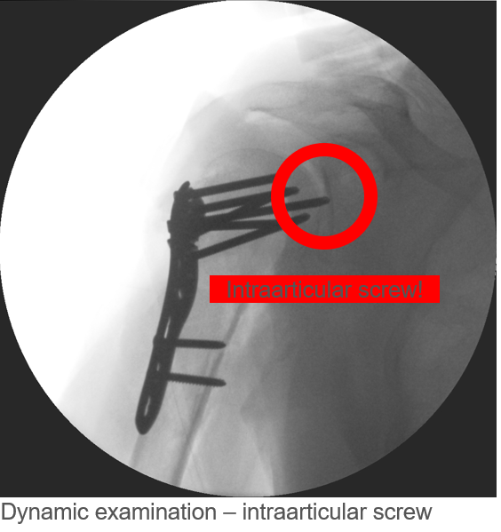
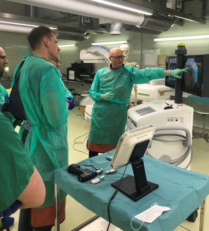
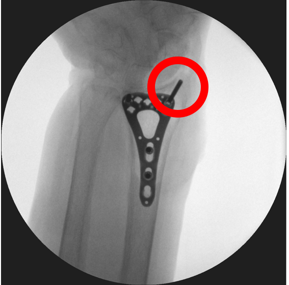
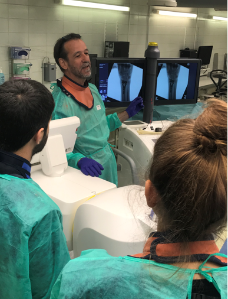
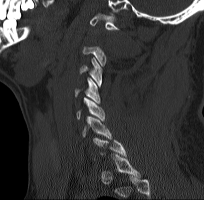
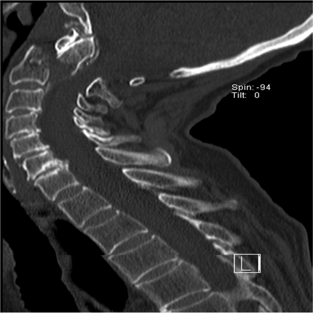

# Módulo 5: Protocolos de Posicionamiento Fluoroscópico para Miembro Superior

## Abstract
**Resumen:** La manipulación del miembro superior bajo control radioscópico expone frecuentemente las manos del cirujano al haz primario (directo), lo que incrementa el riesgo determinístico de daño tisular localizado (p. ej., eritema, radiodermitis a largo plazo). Este módulo detalla las técnicas de posicionamiento del Arco en C para el hombro, codo y muñeca, enfatizando la preferencia de reubicar y manipular el plano anatómico del paciente en lugar de la cinemática pesada del equipo, logrando proyecciones laterales puras y reduciendo los tiempos operatorios con base en literatura biomecánica actual (Giordano et al.).

---

## 1. Introducción y la Vulnerabilidad Ocupacional de las Manos
La anatomía del miembro superior es intrínsecamente más móvil y manipulable que la del miembro inferior. Sin embargo, su proximidad al tórax del paciente y la delicadeza de los procedimientos generan la peligrosa tendencia en los cirujanos de estabilizar las fracturas manteniendo las manos directamente dentro del campo fluoroscópico (*Kaplan et al., 2016*).

La evidencia dosimétrica es contundente: **la dosis directa de radiación incidente sobre las manos es al menos 20 a 100 veces mayor que la dosis recibida por dispersión en los órganos sensibles del tronco** (*Lee et al., 2012; Singer, 2005*). La exposición repetida en las manos sin protección eleva el riesgo determinístico de eritema crónico, cambios atróficos en la piel, radiodermitis y neoplasias cutáneas a largo plazo.

---

## 2. Hombro y Articulación Glenohumeral
El grosor del tórax obliga al tubo generador a utilizar picos de penetración (kVp) y niveles de miliamperaje (mA) sustancialmente mayores, por lo que toda la zona periescapular es un área de alta retrodispersión hacia la cara y tiroides del cirujano.

### 2.1. Proyección Anteroposterior (AP) Verdadera (Perfil de Grashey)
* **Reto Geométrico:** El plano de la cavidad glenoidea no es coronal estricto, sino que está retrovertido aproximadamente 30 a 45 grados.
* **Ejecución Técnica:** En lugar de irradiar de forma ortogonal a la camilla, el Arco en C (ingresando por la cabecera) debe ser rotado en su eje axial hacia lateral para alinear el rayo con la cara articular, de manera que la línea articular glenohumeral se observe sin la superposición de la cabeza humeral.

### 2.2. Proyección Axilar Transversal
* Usualmente requerida para evaluar el encaje de la prótesis o reducciones de fracturas de cuello anatómico en un segundo plano.
* **Posicionamiento:** El tubo emisor se orienta lateralmente y entra paralelo al eje longitudinal del paciente hacia la axila, basculando fuertemente el brazo "C" o rotando al paciente (si está en silla de playa).

---

### 2.3. Estándar AO Trauma (Estación 1): Húmero Proximal y Tornillos Calcar
* **Posicionamiento en Silla de Playa:** El paciente semi-incorporado permite que el Arco en C ingrese perpendicular a la escápula desde la cabecera.
* **Control de Penetración Articular:** En el enclavado anterógrado o placas bloqueadas de húmero proximal, la fluoroscopia dinámica debe corroborar que los tornillos inferomediales (tornillos de soporte del calcar) no penetren en la articulación glenohumeral, rotando el brazo en abducción y rotación externa/interna bajo visualización continua.

### 4.4. Estándar AO Trauma (Estación 2): Radio Distal, DRUJ y Riesgo del Tendón EPL
En la fijación con placa volar de radio distal:
* **Articulación Radiocubital Distal (DRUJ):** Proyecciones oblicuas a 20° de pronación descartan que los tornillos distales penetren en la fosa sigmoidea del radio invadiendo la DRUJ.
* **Tendón Extensor Largo del Pulgar (EPL):** Vistas laterales estrictas y tangenciales dorsales a 30° de inclinación son obligatorias para verificar que los tornillos bicorticales no sobresalgan más de 1 mm por la cortical dorsal en la corredera del EPL (tubérculo de Lister), lo que causaría la atrición y rotura tardía del tendón del pulgar.

---

## 3. Codo y Húmero Distal
La osteosíntesis de olécranon y húmero distal (p. ej., paletas humerales) se realiza generalmente con el paciente en posición decúbito supino o lateral, utilizando apoyabrazos (mesas auxiliares radiolúcidas).

* **AP Verdadera:** El brazo extendido descansando sobre el apoyabrazos en posición supina. El Arco en C emite un haz estrictamente vertical y perpendicular a la camilla.
* **Lateral Pura:** 
  * *Técnica Incorrecta:* Intentar rotar la maquinaria 90 grados (movimiento orbital) alrededor del brazo rígido del paciente, lo cual es ineficiente y riesgoso por los soportes de las mesas.
  * *Técnica Ortodoxa:* **Flexionar el codo del paciente a 90 grados**, apoyando su borde cubital sobre el soporte radiolúcido (pulgar señalando hacia el cénit). El Arco en C no se modifica y se dispara verticalmente. Esta maniobra minimiza el tiempo de uso y optimiza los márgenes isocéntricos.

---

## 4. Muñeca, Mano y la Controversia del Mini-Arco en C

### 4.1. Mini-Arco en C: Ventajas y la Paradoja de Dosis en Manos (Vosbikian et al., 2014)
El Mini-Arco en C (*Mini C-arm*) es muy popular en cirugía de mano y muñeca debido a su portabilidad y reducida emisión de radiación de cuerpo entero. Sin embargo, estudios rigurosos advierten de una paradoja dosimétrica:
* **Incremento de 10 Veces en Dosis a las Manos:** Vosbikian et al. (2014) demostraron un incremento de **10 veces en la dosis de radiación recibida por la mano no dominante del cirujano** con el mini-arco en comparación con el arco en C estándar (*Kaplan et al., 2016*).
* **Causas Clínicas:** La falsa sensación de inocuidad provoca que los cirujanos utilicen el intensificador de imágenes como una mesa de apoyo para operar (*table effect*) o mantengan sus manos en el haz durante la reducción.
* **Normativa en Quirófano:** Aunque se opere con Mini-Arco, **todo el personal de la sala debe portar su EPP plomado completo**, y las manos deben mantenerse a más de 15 cm del haz (*Kaplan et al., 2016; Giordano et al., 2007*).

### 4.2. El Mito y Peligro de los Guantes Plomados (Wagner & Mulhern, 1996)
Muchos cirujanos recurren a guantes plomados con la creencia de que pueden interponer sus manos en el haz:
* **Producción de Dispersión Interna:** La radiación que no es totalmente atenuada genera dispersión secundaria contra la piel dentro del propio guante (*Kaplan et al., 2016*).
* **Aumento Automático de la Dosis (ABC/AERC):** Al detectar la densidad del plomo del guante en el campo, el fluoroscopio eleva automáticamente la técnica de emisión (kVp y mA) al máximo, multiplicando la radiación sobre el paciente y la mano del cirujano.
* **Directriz Estricta:** Los guantes plomados no sustituyen una técnica depurada. **Nunca se deben colocar las manos directamente en el haz.** Para manipular fragmentos o agujas de Kirschner, deben emplearse **pinzas de Kocher, portaagujas o mangos radiolúcidos** que mantengan las manos alejadas del cono de rayos X (*Kaplan et al., 2016; Shao et al., 2014*).

### 4.3. Escafoides: Proyección Oblicua Especial
Para evaluar la longitud del escafoides y el cierre de la fractura sin superposición de los huesos del carpo, el cirujano coloca la muñeca en **desviación cubital extrema y leve extensión dorsal (30°)** antes de realizar el disparo colimado.

---

  
  
  
<em>Figura 5.1: Estación AO Trauma en Húmero Proximal: Posición en silla de playa con arco entrando oblicuo desde craneal, y proyecciones AP verdadera y axilar para corroborar tornillos calcar sin penetración glenoidea.</em>

  
  
  
<em>Figura 5.2: Estación AO Trauma en Radio Distal: Inclinación del haz a 11°-15° para tangenciar la superficie articular radiocarpiana y comprobar que ningún tornillo penetre en la articulación o lesione el tendón extensor largo del pulgar (EPL) en la cortical dorsal.</em>

  
  
  
<em>Figura 5.3: Dificultades de penetración en columna vertebral: fracturas de lámina y pilares articulares ocultas en Rx convencional (Izquierda), y visualización de la unión C7-T1 superpuesta por los hombros (Derecha).</em>

## 5. Conclusión General del Entrenamiento Quirúrgico
El dominio integral del Arco en C —desde su encendido, los límites físicos y dosimétricos (Módulos 1-3) hasta su ejecución en miembro inferior y superior (Módulos 4-5)— constituye un acto de profesionalismo y excelencia clínica. Entender que adaptar la extremidad del paciente es más rápido y seguro que forzar desplazamientos orbitales complejos, y que las manos del cirujano jamás deben entrar en el haz primario, define al traumatólogo moderno bajo la filosofía **S.E.R.**.

---

## Bibliografía
1. **Kaplan, D. J., Patel, J. N., Liporace, F. A., & Yoon, R. S.** (2016). *Intraoperative radiation safety in orthopaedics: a review of the ALARA (As low as reasonably achievable) principle.* Patient Safety in Surgery, 10(1), 27.
2. **Vosbikian, M. M., Ilyas, A. M., Watson, D. D., et al.** (2014). *Radiation exposure to hand surgeons’ hands: a practical comparison of large and mini C-arm fluoroscopy.* Journal of Hand Surgery (Am), 39(9), 1805-1809.
3. **Lee, K., Lee, K. M., Park, M. S., Lee, B., Kwon, D. G., & Chung, C. Y.** (2012). *Measurements of surgeons' exposure to ionizing radiation dose during intraoperative use of C-arm fluoroscopy.* Spine, 37(14), 1240-1244.
4. **Giordano, B. D., Ryder, S., Baumhauer, J. F., et al.** (2007). *Exposure to direct and scatter radiation with use of mini-c-arm fluoroscopy.* Journal of Bone and Joint Surgery (Am), 89(5), 948-952.
5. **Wagner, L. K., & Mulhern, O. R.** (1996). *Radiation-attenuating surgical gloves: effects of scatter and secondary electron production.* Radiology, 200(1), 45-48.
6. **Shao, Z., Guan, Y., & Tan, J.** (2014). *Virtual Reality Aided Positioning of Mobile C-Arms for Image-Guided Surgery.* Advances in Mechanical Engineering, 6, 943025.
